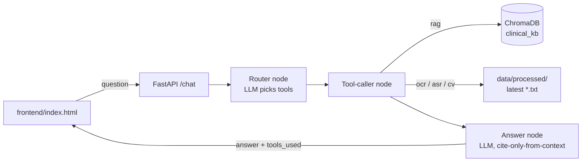

# ClinAssist

ClinAssist is a clinical question-answering assistant built on retrieval-augmented generation (RAG). A clinician asks a question in a web chat. An LLM agent decides which tools it needs: the knowledge base, an OCR'd document, an audio transcript, or a chest X-ray classification. It then answers using only the retrieved material and cites a source for every claim.

> **Status: prototype / portfolio project.** This is not a medical device and must not be used for real clinical decisions. See the [Audit](#audit) for known gaps.

---

## Contents

- [Architecture](#architecture)
- [Tools and methods](#tools-and-methods)
- [Project structure](#project-structure)
- [Setup](#setup)
- [Usage](#usage)
- [API reference](#api-reference)
- [Data currently in the knowledge base](#data-currently-in-the-knowledge-base)
- [Audit](#audit)
- [Recommended next steps](#recommended-next-steps)

---

## Architecture

The project was built in six phases. Each phase is one folder:

| Phase | Folder | What it does |
|---|---|---|
| 1 | `knowledge_base/` | Ingests PDFs and text, embeds them, stores them in ChromaDB; grounded Q&A from the CLI |
| 2 | `ocr/` | Extracts text from documents into `data/processed/*_ocr.txt` |
| 3 | `asr/` | Transcribes audio into `data/processed/*_transcript.txt` |
| 4 | `cv/` | Classifies chest X-rays as NORMAL / PNEUMONIA into `data/processed/*_classification.txt` |
| 5 | `agent/` | LangGraph agent: route → call tools → write a cited answer |
| 6 | `api/` + `frontend/` | FastAPI backend and a single-page chat UI |

### Request flow (`POST /chat`)



### Ingestion flow (`POST /ingest`)

```
upload ─► data/raw/<filename>
   .pdf  ─► pypdf text extraction ─────────────┐
   .txt  ─► read as UTF-8 ─────────────────────┤
   .jpg/.png ─► PyMuPDF text layer → EasyOCR* ─┤─► chunk (800 chars / 150 overlap)
   .mp3/.wav/.m4a ─► Whisper "base" ───────────┘      ─► embed (mpnet multilingual)
                                                       ─► upsert into ChromaDB
* EasyOCR is not installed. See audit finding H3.
```

---

## Tools and methods

### Tech stack

| Layer | Tool | Version (installed) | Used in |
|---|---|---|---|
| Language | Python | 3.11.8 | everywhere |
| LLM provider | Groq Cloud | `groq` 0.37.1, `langchain-groq` 1.1.3 | `agent/`, `knowledge_base/query.py` |
| LLM model | `llama-3.3-70b-versatile` | n/a | router and answer generation |
| Agent framework | LangGraph (`StateGraph`) | 1.2.8 | `agent/orchestrator.py` |
| Vector database | ChromaDB (persistent, local SQLite + HNSW) | 0.5.23 | `knowledge_base/chroma_db/` |
| Embeddings | `sentence-transformers/paraphrase-multilingual-mpnet-base-v2` | sentence-transformers 3.3.1 | ingest and retrieval |
| PDF text | `pypdf` | 5.1.0 | `knowledge_base/ingest.py`, API |
| Document text ("OCR") | PyMuPDF (`fitz`) | 1.28.0 | `ocr/extract.py`, API |
| Speech-to-text | OpenAI Whisper (local, `base` model) + ffmpeg | openai-whisper 20250625 | `asr/transcribe.py`, API |
| Image classification | ViT `nickmuchi/vit-finetuned-chest-xray-pneumonia` (Hugging Face) | transformers 4.46.3, torch 2.12.1 | `cv/classify.py` |
| Backend | FastAPI + Uvicorn | 0.139.0 / 0.49.0 | `api/main.py` |
| Frontend | Vanilla HTML/CSS/JS, `fetch` API | n/a | `frontend/index.html` |
| Config | `python-dotenv` (`.env` → `GROQ_API_KEY`) | 1.0.1 | everywhere |

### Methods

**Chunking.** A fixed-size character sliding window: 800 characters with a 150-character overlap. Whitespace is collapsed first ([`chunk_text`](knowledge_base/ingest.py#L48)). Each chunk is stored with `{source, chunk_index}` metadata.

**Embedding and retrieval.** A multilingual mpnet sentence embedder, so Arabic and English share one vector space. Retrieval is dense top-k with `k = 4`, using Chroma's default distance with no score threshold ([`tool_rag`](agent/orchestrator.py#L58)).

**Grounded generation.** Both prompts tell the model to answer *only* from the supplied context, to tag each claim with `[source: filename]`, and to say so when the context lacks the answer. Temperature is 0 in the agent and 0.1 in `query.py`. The CLI prompt in [`query.py`](knowledge_base/query.py#L33) also asks the model to point out conflicts between chunks.

**Agent orchestration.** A three-node LangGraph state machine (`router → tool_caller → answer_generator → END`) shares one `AgentState` TypedDict.
- **Router.** A few-shot prompt makes the LLM return a comma-separated tool list. The list is filtered against `{rag, cv, asr, ocr}`, and the router falls back to `["rag"]` if nothing valid comes back.
- **Tool caller.** `rag` queries ChromaDB. `ocr`, `asr` and `cv` do **not** run models. Each one reads the most recently modified matching file in `data/processed/`.
- **Answer generator.** One LLM call over the RAG context plus the tool outputs.

**Speech recognition.** Whisper `base`, with the language forced to English.

**Computer vision.** A ViT image classifier with softmax over two labels (NORMAL, PNEUMONIA). The label and confidence are written to text so the agent can read them.

**"OCR".** PyMuPDF `page.get_text()`, which only reads an *embedded text layer*. It is not optical character recognition (see finding H3).

---

## Project structure

```
clinassist/
├── .env                      # GROQ_API_KEY (secret, keep out of git)
├── .gitignore                # currently EMPTY, see finding C1
├── requirements.txt          # incomplete, see finding M6
├── agent/
│   └── orchestrator.py       # LangGraph agent + tool functions (CLI entry point too)
├── api/
│   └── main.py               # FastAPI: /health, /chat, /ingest
├── asr/
│   └── transcribe.py         # Whisper transcription → data/processed/*_transcript.txt
├── cv/
│   └── classify.py           # ViT chest X-ray classifier → *_classification.txt
├── ocr/
│   └── extract.py            # PyMuPDF text extraction → *_ocr.txt
├── knowledge_base/
│   ├── ingest.py             # chunk + embed + upsert everything in data/raw & data/processed
│   ├── query.py              # standalone grounded Q&A (no agent)
│   └── chroma_db/            # persistent vector store (~70 MB)
├── data/
│   ├── raw/                  # source files (PDF, JPG, MP3)
│   └── processed/            # text produced by OCR / ASR / CV
├── frontend/
│   └── index.html            # chat UI, calls http://localhost:8000
└── venv/                     # Python 3.11 virtual environment
```

---

## Setup

Prerequisites: Python 3.11, [ffmpeg](https://ffmpeg.org/) on `PATH` (Whisper needs it), and a [Groq API key](https://console.groq.com/).

```powershell
cd clinassist
python -m venv venv
venv\Scripts\activate

# requirements.txt is incomplete; this installs everything the code imports:
pip install chromadb==0.5.23 sentence-transformers==3.3.1 pypdf==5.1.0 python-dotenv==1.0.1 `
            groq langchain-groq langgraph fastapi uvicorn python-multipart `
            pymupdf openai-whisper torch torchvision transformers==4.46.3 pillow

# optional, needed for image OCR via the API:
pip install easyocr
```

Create `.env`:

```
GROQ_API_KEY=your_key_here
```

> The code appends a hard-coded, machine-specific ffmpeg path to `PATH` in `agent/orchestrator.py`, `api/main.py` and `asr/transcribe.py`. On any other machine, install ffmpeg globally or edit those lines.

The first run downloads the embedding model, the ViT model and Whisper `base` into the Hugging Face and Whisper caches.

---

## Usage

### 1. Build the knowledge base

Put PDFs or `.txt` files in `data/raw/`, then run:

```powershell
python knowledge_base\ingest.py
```

> ⚠️ Re-running this **duplicates** every chunk (finding H1). Delete `knowledge_base\chroma_db\` first if you need a clean rebuild.

### 2. (Optional) Pre-process media

```powershell
python ocr\extract.py "data\raw\Good Discharge Summary Sample -Medicine.pdf"
python asr\transcribe.py data\raw\audio-sample-4.mp3
python cv\classify.py data\raw\pneumo.jpg
python knowledge_base\ingest.py
```

### 3. Ask questions

From the CLI, without the agent:

```powershell
python knowledge_base\query.py "What are the signs of severe dehydration in children?"
```

From the CLI, with the agent:

```powershell
python agent\orchestrator.py "What does the chest x-ray show and is it consistent with WHO guidelines?"
```

Through the web app:

```powershell
python -m uvicorn api.main:app --reload --port 8000
# then open frontend\index.html in a browser
# Swagger docs: http://localhost:8000/docs
```

---

## API reference

| Method | Path | Body | Returns |
|---|---|---|---|
| GET | `/health` | none | `{"status": "ok", "service": "ClinAssist API"}` |
| POST | `/chat` | `{"question": "..."}` | `{"question", "answer", "tools_used": ["rag", ...]}` |
| POST | `/ingest` | multipart `file` (.pdf .txt .jpg .jpeg .png .mp3 .wav .m4a) | `{"filename", "chunks_added", "message"}` |

---

## Data currently in the knowledge base

Measured directly from `chroma.sqlite3` (collection `clinical_kb`) on 2026-10-20:

| Source | Stored chunks | Unique chunks | On disk? |
|---|---:|---:|---|
| WHO Pocket Book of Hospital Care for Children, 2nd ed. (2013) | 5,595 | 1,119 | ✅ |
| `9789240121805-eng.pdf` (WHO publication) | 1,270 | 635 | ❌ orphaned |
| Good Discharge Summary Sample (PDF) | 50 | 10 | ✅ |
| Good Discharge Summary Sample (`_ocr.txt`) | 20 | 10 | ✅ (same text as the PDF) |
| `audio-sample-4_transcript.txt` | 22 | 11 | ✅ |
| `pneumo_classification.txt` | 1 | 1 | ✅ |
| **Total** | **6,958** | **1,786** | |

Files in `data/raw/` that are **not** in the knowledge base: `General-Check-Up-Report.jpg` (its OCR output is a 0-byte file), `pneumo.jpg` (only its classification is stored) and `audio-sample-4.mp3` (only its transcript is stored).

---

## Audit

**Scope.** All source files (`agent/`, `api/`, `asr/`, `cv/`, `ocr/`, `knowledge_base/`, `frontend/`), configuration (`.env`, `.gitignore`, `requirements.txt`), the installed virtual environment, and the contents of the ChromaDB store. The project is not a git repository, so there was no history to review.

**Method.** Manual code review, plus direct inspection of the vector store (chunk counts, duplicate detection, token-length measurement using the embedder's own tokenizer) and of the cached models.

**Severity scale.** **Critical** means fix before sharing the code. **High** means a broken feature or a real security risk. **Medium** means a quality or maintainability issue. **Low** is polish.

### Summary

| ID | Severity | Finding |
|---|---|---|
| C1 | Critical | Live API key in `.env` and an empty `.gitignore` |
| H1 | High | 74% of the vector store is duplicate chunks |
| H2 | High | Upload filename is used unsanitised (path traversal / overwrite) |
| H3 | High | "OCR" is not OCR, and image upload fails (EasyOCR not installed) |
| H4 | High | Stored XSS: LLM output is rendered as raw HTML |
| H5 | High | OCR/ASR/CV tools return "latest file", not the file the question is about |
| H6 | High | Unauthenticated API with `CORS *`; patient data is sent to a third-party LLM |
| M1 | Medium | ~32% of each chunk is never embedded (128-token model limit) |
| M2 | Medium | Models are reloaded on every request; `/ingest` blocks the event loop |
| M3 | Medium | No relevance threshold, and citations have no page numbers |
| M4 | Medium | CV is not reachable from the API |
| M5 | Medium | Knowledge base drifts from disk (orphans, double ingestion) |
| M6 | Medium | `requirements.txt` is incomplete and stale |
| M7 | Medium | Hard-coded, machine-specific ffmpeg path |
| M8 | Medium | No tests, evaluation set, logging or version control |
| L1–L6 | Low | Assorted code-quality items |

### Critical

**C1: Secret committed-in-waiting.** `.env` holds a live `GROQ_API_KEY`, and `.gitignore` is a 0-byte file. The first `git init && git add .` would commit the key. It would also commit the 70 MB vector DB, the ~10 MB of raw data and the whole `venv/`.
*Fix:* add `.env`, `venv/`, `knowledge_base/chroma_db/`, `data/`, and `__pycache__/` to `.gitignore`. Rotate the key if this folder has ever been shared or uploaded.

### High

**H1: The vector store is about three-quarters duplicates.** [`ingest.py`](knowledge_base/ingest.py#L99) and [`api/main.py`](api/main.py#L113) generate IDs with `uuid4()`, so `upsert` never matches an existing row and every re-ingest adds a full new copy. The store holds 6,958 chunks, of which only 1,786 are unique. The WHO pocket book is stored 5 times over. With `k = 4`, one query often retrieves the *same* passage several times, which wastes the context and hides other relevant material.
*Fix:* use deterministic IDs, e.g. `sha1(f"{source}:{chunk_index}")`, or `collection.delete(where={"source": name})` before re-ingesting. Rebuild the store once.

**H2: Path traversal and overwrite in `/ingest`.** [`save_path = RAW_DIR / file.filename`](api/main.py#L231) trusts the client's filename. A name like `..\..\agent\orchestrator.py` writes outside `data/raw/`. On Windows, an absolute name such as `C:\...` makes `pathlib` discard `RAW_DIR` entirely. Uploading a file with the same name as an existing one silently overwrites it. There is also no size limit.
*Fix:* use `Path(file.filename).name`, or better, a server-generated name. Check that the resolved path is inside `RAW_DIR` and enforce a maximum size.

**H3: OCR doesn't do OCR.** [`ocr/extract.py`](ocr/extract.py#L21) uses PyMuPDF `get_text()`, which only reads text that is already embedded in a digital PDF. Scanned documents and photos produce nothing. Evidence: `General-Check-Up-Report_ocr.txt` is **0 bytes**. The API's image path falls back to [`easyocr`](api/main.py#L154), which is **not installed** and not in `requirements.txt`, so every image upload ends in HTTP 500 "OCR failed". (A `microsoft/trocr-base-printed` model is in the HF cache, apparently from an earlier experiment, but no code uses it.)
*Fix:* add a real OCR engine (EasyOCR, PaddleOCR, Tesseract via `pytesseract`, or TrOCR) and use it whenever the text layer is empty.

**H4: Stored XSS in the chat UI.** [`bubble.innerHTML = content.replace(...)`](frontend/index.html#L302) renders the LLM's answer as HTML. The answer is built from uploaded documents, so a malicious upload containing ``, or a prompt injection that makes the model output it, runs script in the clinician's browser. The user's own question goes through the same path.
*Fix:* set `textContent` and use CSS `white-space: pre-wrap`, or sanitise with DOMPurify if markdown rendering is needed.

**H5: Context tools are not tied to the question.** [`tool_ocr`, `tool_asr` and `tool_cv`](agent/orchestrator.py#L70-L100) each return whichever `*_ocr.txt`, `*_transcript.txt` or `*_classification.txt` has the newest modification time. "Summarize John Smith's discharge summary" returns the last OCR'd file, whoever it belongs to. In a clinical setting this risks mixing up patients.
*Fix:* key artefacts by patient or encounter ID (or let the router name a file), and filter retrieval with Chroma `where` metadata.

**H6: No access control, and data leaves the machine.** The API has no authentication and allows [`CORS *`](api/main.py#L72-L77), so any web page the user visits can call `/chat` and `/ingest` on `localhost:8000`. Every question plus the retrieved patient text is sent to Groq's cloud API. There is no audit log, no de-identification step, and no data-processing agreement. For real PHI this conflicts with HIPAA, GDPR and similar regimes.
*Fix:* add auth (even an API key header), restrict CORS to the UI origin, log requests, and consider de-identification or a self-hosted LLM for patient data.

### Medium

**M1: Chunks are longer than the embedder can see.** `paraphrase-multilingual-mpnet-base-v2` has `max_seq_length = 128` tokens. An 800-character chunk is a median of **187 tokens**, and 391 of 400 sampled chunks exceed the limit. On average only **~68%** of each chunk is embedded. The tail is invisible to search but still goes to the LLM.
*Fix:* use roughly 400–450-character chunks, or switch to an embedder with a longer context (e.g. `BAAI/bge-m3` at 8k tokens, which is also multilingual). Prefer a sentence- or section-aware splitter over a raw character window, which cuts mid-word and flattens tables.

**M2: Performance.** [`tool_rag`](agent/orchestrator.py#L60) and [`ingest_text`](api/main.py#L109) rebuild the SentenceTransformer model and the Chroma client on **every call**, and Whisper is reloaded on every audio upload. `/ingest` is `async def` but does blocking CPU work (Whisper, embedding), so `/chat` and `/health` freeze while a file is processed. Every chat also makes two sequential LLM calls (router + answer).
*Fix:* load the models and the collection once at startup. Make `/ingest` a plain `def`, or offload the work with `run_in_threadpool` or a background task.

**M3: Weak grounding signals.** Retrieval always returns 4 chunks however irrelevant they are, so the "say you don't know" behaviour depends entirely on the LLM. Citations give only a filename. For a 400-page WHO book that cannot be checked, because page numbers are not stored. The agent prompt also lacks the "flag conflicting sources" rule that `query.py` has.
*Fix:* apply a distance threshold, store `page` in the metadata, and share one system prompt between the CLI and the agent.

**M4: CV is effectively offline in the app.** Image uploads go to OCR and never to the classifier. `tool_cv` only reads a cached result, so a new X-ray uploaded in the UI is never classified. The model was fine-tuned on paediatric pneumonia X-rays (a research dataset). It is not validated for clinical use, and the only test image (`pneumo.jpg`) is a 5 KB thumbnail.
*Fix:* add an `/classify` endpoint, or detect radiographs in `/ingest` and run the classifier. Add a "research only" disclaimer to the output.

**M5: The knowledge base drifts from disk.** `9789240121805-eng.pdf` contributes 1,270 chunks but no longer exists in `data/raw/`. Nothing removes stale sources. The discharge summary is indexed twice under two names (PDF + `_ocr.txt`), because `ingest.py` reads both `data/raw` and `data/processed`.
*Fix:* track ingested files (name + hash), remove deleted ones, and skip `_ocr.txt` files whose source PDF is already indexed.

**M6: Dependencies.** `requirements.txt` lists 5 packages. The code needs about 15: it omits `langgraph`, `langchain-groq`, `fastapi`, `uvicorn`, `python-multipart`, `pymupdf`, `openai-whisper`, `torch`, `transformers`, `pillow` and `easyocr`. It pins `groq==0.13.1` while 0.37.1 is installed.
*Fix:* regenerate it from the venv (`pip freeze`), or keep a curated pinned list (see [Setup](#setup)).

**M7: Hard-coded ffmpeg path** in [`agent/orchestrator.py:21`](agent/orchestrator.py#L21), [`api/main.py:27`](api/main.py#L27) and [`asr/transcribe.py:2`](asr/transcribe.py#L2). It only works on this machine and this user account.
*Fix:* rely on a global ffmpeg install, or read an optional `FFMPEG_DIR` from `.env`.

**M8: No safety net.** There are no unit tests, no retrieval or answer evaluation set, no structured logging, no git history, and no medical disclaimer in the UI. (`ingest.py` also points to "README.md for free dataset suggestions", but the README was empty.)
*Fix:* start with a 20–30 question golden set measuring retrieval hit-rate and citation correctness, plus pytest for the chunker and the API.

### Low

- **L1.** The `operator.add` reducer on `tool_outputs` combined with nodes returning `{**state, ...}` means the final node re-appends the existing list, so outputs are duplicated in the final state ([orchestrator.py:47](agent/orchestrator.py#L47)). It is harmless today because the answer is generated first. Return only the changed keys.
- **L2.** `tool_cv` imports `torch`, `PIL` and `transformers` but never uses them ([orchestrator.py:72-74](agent/orchestrator.py#L72-L74)). `import uuid` is duplicated as `_uuid` in `api/main.py`, and `load_documents` and `os` are imported but unused.
- **L3.** `AutoFeatureExtractor` is deprecated for vision models. Use `AutoImageProcessor` ([cv/classify.py:43](cv/classify.py#L43)).
- **L4.** ASR forces `language="en"` while the embedding layer is chosen for Arabic support. Use auto-detect, or make it configurable.
- **L5.** Two PDF libraries (pypdf for ingestion, PyMuPDF for "OCR") produce slightly different text from the same file. Standardise on one.
- **L6.** The API URL is hard-coded in the frontend (`http://localhost:8000`), and the API accepts `.ogg` and `.flac` internally while rejecting them at the extension check.

### What's done well

- **Citation-first prompting** from Phase 1, with explicit "don't guess" instructions and low temperature. This is the right default for a clinical tool.
- **A clean, phased architecture.** Every modality reduces to plain text in `data/processed/`, so new tools plug into one generic ingester.
- **A multilingual embedder**, chosen deliberately for Arabic and English content.
- **A safe router fallback** to RAG when the LLM returns nothing usable, with output filtered against an allow-list of tool names.
- **Typed API schemas** (Pydantic) and auto-generated Swagger docs.
- Clear docstrings that explain the *why* behind each phase.

---

## Recommended next steps

In priority order:

1. Fix `.gitignore`, rotate the Groq key, then `git init` (C1).
2. Use deterministic chunk IDs and rebuild the vector store (H1, M5).
3. Sanitise upload filenames and render answers with `textContent` (H2, H4).
4. Add real OCR and wire CV into `/ingest` (H3, M4).
5. Load models once at startup and reduce chunk size to fit the embedder (M1, M2).
6. Add page-level citations and a relevance threshold (M3).
7. Scope tool outputs to a patient or document instead of "latest file" (H5).
8. Add a small evaluation set and tests (M8).
9. Before any real patient data: auth, audit logging, de-identification, and an LLM hosting decision (H6).

---

*Disclaimer: ClinAssist is an educational prototype. Its outputs are not medical advice and have not been clinically validated.*
